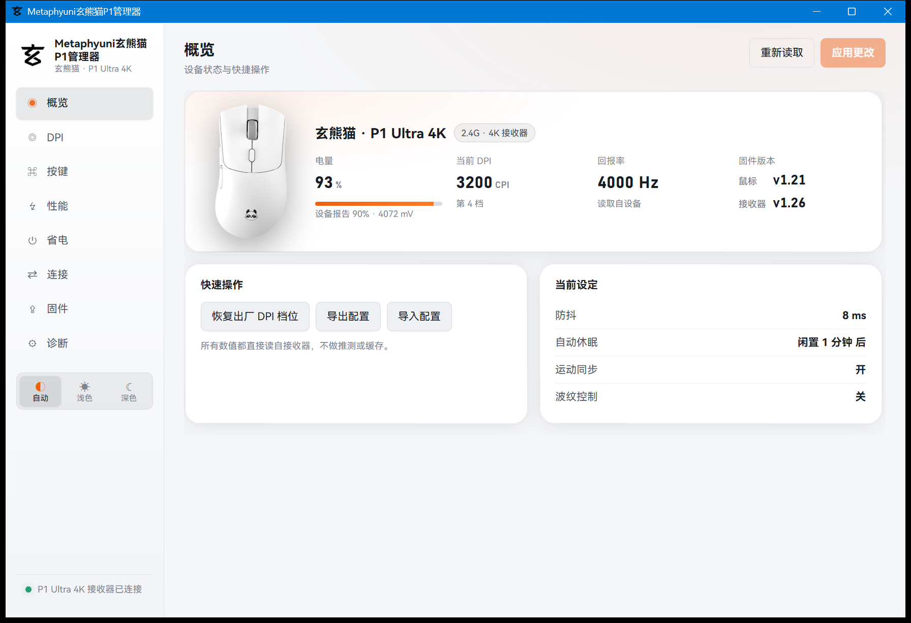

# 玄派玄熊猫 P1 系列鼠标第三方管理器

**Metaphyuni 玄派 · 玄熊猫 P1 系列**（P1 / P1 Pro / P1 Ultra / P1 Ultra 4K）的第三方桌面管理器。
Rust + Tauri 2 写成，发布物是**一个 exe**，不装驱动、不联网、不常驻服务。

本项目在 **P1 Ultra 4K**（接收器 `VID 0x3554 / PID 0xF5AC`，固件 鼠标 v1.21 / 接收器 v1.26）上逐项实测；
同系列的 P1、P1 Pro 用的是同一套 CompX 方案闪存布局，理论上通用，但**没有实机验证过**，读取前请先备份配置。

> **非官方项目**：与 Metaphyuni / 玄派及其关联公司无任何关系，未获授权或支持。
> 工具会**直接读写鼠标闪存**。所有写操作都有左键守卫（不允许把最后一个「左键」改掉）和回读校验，
> 但**风险自担**：刷错配置可能让按键失效，需要另一只鼠标或恢复出厂才能救回。请先导出备份。



## 为什么会有这个工具

官方 MetaHub 只放出全部设置的一小部分。这个项目把协议层重新实现了一遍：能读的全部读出来，
能写的逐项在真机上验证——**验证不了的就不写**，代码注释里会直接标成「猜的」。

举个具体的例子：官方驱动没有「组合键」和「宏」的界面，但硬件其实支持。本项目把两块区域解出来了，
并且都是**按下去看系统收到什么**来确认的，不是靠读文档推断：

- 组合键：把 DPI 键绑成 `Ctrl+C`，按下后 Windows 确实收到 `Ctrl+C`；
- 宏：把两步 `F24` 的宏绑到前进键，按下后系统收到两次 `F24`，间隔与设定的 250 ms 吻合。

## 功能

| 功能 | 状态 | 说明 |
|---|---|---|
| DPI 档位（数值 / 颜色 / 生效档数） | ✅ 实测 | 8 个槽位，X / Y 可不同 |
| 当前 DPI 档位 | ✅ 实测 | 写入后 2.5 秒回读校验；若被固件改回会明确报错 |
| 回报率 | ✅ 实测 | 125 / 250 / 500 / 1000 / 2000 / 4000 Hz |
| LOD 抬升高度 | ✅ 实测 | 低 / 中 / 高（存储值顺序是乱的：1 = 中） |
| 按键防抖 | ✅ 实测 | **两个地址都写**（`0x0084` 的记录 + `0x00A9` 高级行），实测两者互不联动 |
| 运动同步 / 波纹控制 / 角度修正 | ✅ 实测 | |
| 自动休眠时间 | ✅ 实测 | `0x00AD`，单位 10 秒；设成 1 时约 20 秒后断连，设成 6 时几分钟都不睡 |
| 传感器性能模式 | ⚠️ 可写 | `0x00B9` + `0x00BA` 校验对；0 = 基本，1 = 竞技固件，2 含义未知 |
| 六个按键绑定 | ✅ 实测 | 类别表全解，含「未在本机验证」分组 |
| **组合键 / 多媒体键** | ✅ 实测 | 把 DPI 键设成 Ctrl+C，按下后系统确实收到 |
| **宏（多步按键序列）** | ✅ 实测 | 两步 F24，按下后收到两次，间隔与设定一致 |
| 滚轮灯（模式 / 亮度 / 速度） | ✅ 实测 | |
| 配置档位切换 | ✅ 实测 | |
| 2.4G 配对 / 解除配对 | ✅ 实测 | |
| 固件版本 / 电量 / 连接状态 | ✅ 实测 | 电量取命令 `0x04` 的真实回复，不是固定的 100% |
| 蓝牙档电量（HID-over-GATT） | ⚠️ 部分 | 蓝牙模式下能读电池服务；配置通道不存在 |
| 固件升级 | ⚠️ 谨慎 | 通道与包校验已实现，**未经实际刷写验证** |
| 配置导出 / 导入 | ✅ 实测 | 导入前做结构校验 + 左键守卫 |

界面中文，跟随系统深浅色。

## 协议要点

每个地址的来源、为什么这么写、哪一条是推测，都写在
[`src-tauri/src/protocol.rs`](src-tauri/src/protocol.rs) 的注释里。摘要：

```
帧：17 字节，HID report id 0x08，usage page 0xFF02
[0] 0x08        [1] 命令        [2] 标志（0x01 = 设备拒绝）
[3][4] 地址 大端  [5] 长度      [6..15] 数据  [16] 校验 = (0x55 - sum(前 16 字节)) & 0xff
```

| 地址 | 内容 |
|---|---|
| `0x0000` | 回报率、DPI 档数、当前档（值 + `0x55-值` 对） |
| `0x000A` | LOD |
| `0x000C` | 8 个 DPI 档记录，每档 4 字节 |
| `0x002C` | 8 个档位颜色，4 字节一条 |
| `0x004C` | 滚轮灯（模式 / 亮度 / 速度） |
| `0x0060` | 6 个按键记录，每键 `[类别][参数][参数][校验]` |
| `0x00A9` | 高级行：防抖、运动同步、休眠、角度、波纹 |
| `0x00AD` | 休眠时间（单位 10 秒） |
| `0x00B5` | 传感器性能行：`[0x00][0x55][型号低][型号高][模式][0x55-模式]` |
| `0x0100` | 每按键一个 32 字节组合键槽（事件列表） |
| `0x0300` | 每按键一个 384 字节宏区 |

写入不是「发一条提交帧就完了」：实测**不发任何提交帧，改动也会跨过休眠保留**，
所以本工具靠「写后回读 + 结构校验」判断是否生效，而不是相信那个提交帧。

## 构建

需要 **Rust 1.77+**、**MSYS2 / MinGW-w64**（GNU 工具链）、系统 **WebView2 运行时**（Win10/11 一般自带）。

```bash
pacman -S mingw-w64-x86_64-gcc mingw-w64-x86_64-pkgconf
bash build.sh          # 产物：out/Metaphyuni玄熊猫P1管理器.exe
```

可选：`UPX=1 bash build.sh`（用 upx 压缩最终 exe，需现代版 upx）、`STATIC=1`（静态 CRT）。

WebView2Loader.dll 已内嵌进 exe（见 `vendor/webview2-com-sys` 的本地补丁），发布物只有 exe。

## 命令行诊断

不带参数进界面；带参数是诊断模式，用来在没有界面的情况下核对协议：

```bash
p1studio.exe --probe            # 快速体检
p1studio.exe --conn             # 链路 / 配对 / 固件版本
p1studio.exe --dump             # 完整配置 JSON
p1studio.exe --newfeatures      # 逐项写入并还原（档位、灯、按键、组合键）
p1studio.exe --macro 5 --keep   # 给 5 号键写一个宏并保留
p1studio.exe --stage            # 写入活动档位，观察 14 秒有没有被改回
p1studio.exe --sleep 1 --watch  # 休眠设成 10 秒，看多久断连
p1studio.exe --persist none     # 暂存一个字节但不提交，验证是否落盘
```

## 目录

```
src-tauri/src/protocol.rs   协议编解码：帧、记录、校验、组合键槽、宏区（注释即协议文档）
src-tauri/src/hid.rs        HID 传输层：唤醒、分帧、写入、提交、电量
src-tauri/src/lib.rs        Tauri 命令与诊断入口
src-tauri/src/ble.rs        蓝牙档的电池读取（HID-over-GATT）
src-tauri/src/env.rs        WebView2 运行时探测
ui/                         界面（原生 JS，无框架、无构建步骤）
vendor/webview2-com-sys     上游 crate 的本地补丁：把 WebView2Loader 内嵌进 exe
```

## 参考的开源项目

协议不是凭空猜的。下面这些仓库的**公开结论**被拿来交叉验证，然后逐条在本机实测；
对不上就按实测改，实测不了的就在注释里标成推测。**没有复制任何代码**。

| 仓库 | 许可证 | 从这里用到了什么 |
|---|---|---|
| [Qehbr/m913-ctl](https://github.com/Qehbr/m913-ctl) | GPL-3.0 | 同族（Areson 修订版）的宏区布局：`0x0300`、384 字节/槽、名称+事件数+5 字节事件+校验；回报率与 DPI 寄存器 |
| [mateusands/open-m711pro](https://github.com/mateusands/open-m711pro) | 未标注 | 组合键槽的逐字节实例（Ctrl+C 的 `04 80 01 00 … c1`）、槽与按键一一对应、多媒体 usage 表 |
| [OpenMouse-Project/mouse-protocol](https://github.com/OpenMouse-Project/mouse-protocol) | AGPL-3.0-or-later | ATK 系列的地址表与 `advanced` 行结构（防抖 `0xA9`、运动同步 `0xAB`、休眠 `0xAD`、波纹 `0xB1`）、传感器性能行 `0xB5` |
| [alexfrih/mchose-linux](https://github.com/alexfrih/mchose-linux) | 见仓库 | 帧格式与校验规则（`0x55 - sum`）、写入分帧方式 |
| [Ap0LoG1zE/EZ2.4G](https://github.com/Ap0LoG1zE/EZ2.4G) | 见仓库 | 2.4G 外设的电量查询命令（`0x04`）与回复布局 |

另有两份在研究中作为交叉验证的协议资料，**原始仓库地址未记录**，因此不列链接：
一份是 CompX 方案的共享类别表（按键 class 0x00–0x0B 的语义），
一份是 Cherry Xtrfy M64 的配置协议文档（同族 CompX 芯片，用于确认帧结构）。

关于许可证需要说清楚：参考项目里有 GPL-3.0 与 AGPL-3.0。本项目**只取了协议事实**
（地址、字节布局、命令号），代码是独立写的，没有链接也没有拷贝它们的任何源码，因此本项目按 MIT 发布。
如果你认为其中有应当调整的地方，请开 issue。

## 许可

MIT（见 [LICENSE](LICENSE)）。`vendor/webview2-com-sys` 保留上游 MIT；
`ui/assets/devices/` 的产品图版权归厂商，仅用于识别硬件。
